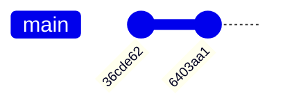

# Demystifying Git

A presentation for **PyLadies Brussels**

by **Bastien Gorissen**

2026-10-29

---

## ...Git is hard

![[xkcd_git.png]]

---
## Or is it?

Today, we'll explore ways to make Git more approachable.

What we'll cover:
1. What is Git?
2. How to use it?
3. How it actually works!

---
## What is Git?

Git is a tool to keep track of changes in your code.

It is built to be
- **Fast**
- **Safe**
- **Decentralized**

Once you commit something to Git, it is hard to completely lose it. And if you synchronize with a server (like Github), it's even harder.

---

## Working locally

To use Git, no need to connect to any server.
90% of the Git commands you'll use act *locally*, and don't depend on an Internet connection.

Just grab Git at https://git-scm.com/ and you're off to the races.

---

## Installation tip

> [!Tip] Select your editor
> While installing Git, you will be given the choice to select a text editor.
> 
> By default, Git uses Vim, a very good but weird text editor.
> 
> You might want to use a more familiar one.

---
## Creating a repository

The only thing you need to get started is a "repo" (short for *repository*). It's basically a directory you want Git to observe for changes.

To create one, open a terminal in the folder you want to use and use the following command :

```git

git init
```

--

Here is how to create a repository in your home directory completely from the terminal.

```shell
~$ cd
~$ mkdir pyladies
~$ cd pyladies
~/pyladies$ git init 
```

--

Expected output

```shell
Initialized empty Git repository in /home/grungi/pyladies/.git/
```

Note the `/.git/` subfolder at the end!

---
## How Git looks at repos

Git will look at the current directory for a `.git` subfolder. If none is found, it will go up the file tree to find another one.

![[Demystifying Git 2026-10-28 22.15.18.excalidraw.svg|400]]

---
## Saying hello

If this is your first time using Git, it is usually a good idea to tell it who you are. Otherwise, Git will remind you to do so frequently.

```shell
~/pyladies$ git config --global user.name "Bastien Gorissen"
~/pyladies$ git config --global user.email "bastien@teampanoptes.be"
```

**⚠️** This is not an account, nor does Git send you any emails. It's information that will be used to "sign" commits.

---
## A first commit

Right now, we have created an empty repository. So let's start working! Let's create a simple Python script (you can do it in an editor if you prefer).

```shell
~/pyladies$ echo "print('Hello, world!')" >> helloworld.py
```

--

Now that we have a file with some code, let's tell Git we want to save it.

```shell
~/pyladies$ git add helloworld.py
~/pyladies$ git commit -m "Add hello world code"
```

Congratulations! Your precious code has been saved inside the Git repository for safekeeping.

---
## What just happened?

We have done 2 things:

1. Marked the `helloworld.py` file to be saved into the Git repo's history.
2. Created a new commit containing a snapshot of the `helloworld.py` file.

--

You should have gotten a result similar to this:

```shell
[main (root-commit) 36cde62] Add hello world code
 1 file changed, 0 insertions(+), 0 deletions(-)
 create mode 100644 helloworld.py
```

You can see your commit message, but also `36cde62` (yours will be different), which is the unique ID, or *hash*, of the commit.

It also shows you on which *branch* (here, `main`) the commit has been saved.

--
Graphically, the current history looks like this:


Or, via a command

```shell
~/pyladies$ git log --oneline
36cde62 (HEAD -> main) Add hello world code
```

---
## Let's work some more

Let's add some more code to our program.

```shell
~/pyladies$ echo "a = 3" >> helloworld.py
```

And commit this new version

```shell
~/pyladies$ git add helloworld.py
~/pyladies$ git commit -m "Added int variable"
```

--

Here's the state of our history



```shell
~/pyladies$ git log --oneline
6403aa1 (HEAD -> main) Added int variable
36cde62 Add hello world code
```

Try without `--oneline` to see the full hash of the commit.

---

## A note on hashes

Everything in Git has a unique ID, called a hash.

The commits, but also tags, or every version of every file stored in the history.

There's no risk of having 2 things with the same hash.

--

The hash function used by Git is SHA-1, and basically takes an input (like the content of a file) and spits out a 160-bit output.

160 bits mean $2^{160}$ possibilities.

--

![[slide40-1.png]]

---

