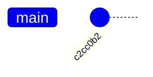
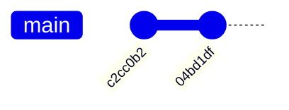
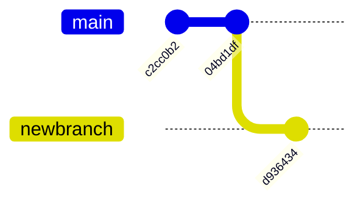
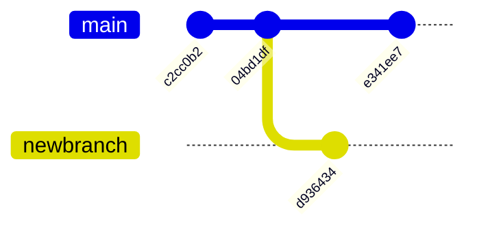
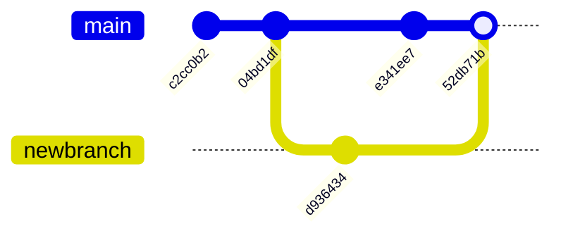

# Demystifying Git

A presentation for **PyLadies Brussels**

by **Bastien Gorissen**

2026-10-29

---

## ...Git is hard

![[xkcd_git.png]]

---
## Or is it?

Today, we'll explore ways to make Git more approachable.

What we'll cover:
1. What is Git?
2. How to use it?
3. How it actually works!

---
## What is Git?

Git is a tool to keep track of changes in your code.

It is built to be
- **Fast**
- **Safe**
- **Decentralized**

Once you commit something to Git, it is hard to completely lose it. And if you synchronize with a server (like Github), it's even harder.

---

## Working locally

To use Git, no need to connect to any server.
90% of the Git commands you'll use act *locally*, and don't depend on an Internet connection.

Just grab Git at https://git-scm.com/ and you're off to the races.

---

## Installation tip

> [!Tip] Select your editor
> While installing Git, you will be given the choice to select a text editor.
> 
> By default, Git uses Vim, a very good but weird text editor.
> 
> You might want to use a more familiar one.

---
## Creating a repository

The only thing you need to get started is a "repo" (short for *repository*). It's basically a directory you want Git to observe for changes.

To create one, open a terminal in the folder you want to use and use the following command :

```git

git init
```

--

Here is how to create a repository in your home directory completely from the terminal.

```shell-command
~$ cd
~$ mkdir pyladies
~$ cd pyladies
~/pyladies$ git init 
```

--

Expected output

```shell
Initialized empty Git repository in /home/grungi/pyladies/.git/
```

Note the `/.git/` subfolder at the end!

---
## How Git looks at repos

Git will look at the current directory for a `.git` subfolder. If none is found, it will go up the file tree to find another one.

![[Demystifying Git 2026-10-28 22.15.18.excalidraw.svg|400]]

---
## Saying hello

If this is your first time using Git, it is usually a good idea to tell it who you are. Otherwise, Git will remind you to do so frequently.

```shell
~/pyladies$ git config --global user.name "Bastien Gorissen"
~/pyladies$ git config --global user.email "bastien@teampanoptes.be"
```

**⚠️** This is not an account, nor does Git send you any emails. It's information that will be used to "sign" commits.

---
## A first commit

Right now, we have created an empty repository. So let's start working! Let's create a simple Python script (you can do it in an editor if you prefer).

```shell
~/pyladies$ echo "print('Hello, world!')" >> helloworld.py
```

--

Now that we have a file with some code, let's tell Git we want to save it.

```shell
~/pyladies$ git add helloworld.py
~/pyladies$ git commit -m "Add hello world code"
```

Congratulations! Your precious code has been saved inside the Git repository for safekeeping.

---
## What just happened?

We have done 2 things:

1. Marked the `helloworld.py` file to be saved into the Git repo's history.
2. Created a new commit containing a snapshot of the `helloworld.py` file.

--

You should have gotten a result similar to this:

```shell
[main (root-commit) c2cc0b2] Add hello world code
 1 file changed, 0 insertions(+), 0 deletions(-)
 create mode 100644 helloworld.py
```

You can see your commit message, but also `36cde62` (yours will be different), which is the unique ID, or *hash*, of the commit.

It also shows you on which *branch* (here, `main`) the commit has been saved.

--
Graphically, the current history looks like this:



Or, via a command

```shell
~/pyladies$ git log --oneline

c2cc0b2 (HEAD -> main) Add hello world code
```

---
## Let's work some more

Let's add some more code to our program.

```shell
~/pyladies$ echo "a = 3" >> helloworld.py
```

And commit this new version

```shell
~/pyladies$ git add helloworld.py
~/pyladies$ git commit -m "Added int variable"
```

--

Here's the state of our history



```shell
~/pyladies$ git log --oneline

04bd1df (HEAD -> main) Added int variable
c2cc0b2 Add hello world code
```

Try without `--oneline` to see the full hash of the commit.

---

## A note on hashes

Everything in Git has a unique ID, called a hash.

The commits, but also tags, or every version of every file stored in the history.

There's no risk of having 2 things with the same hash.

--

The hash function used by Git is SHA-1, and basically takes an input (like the content of a file) and spits out a 160-bit output.

160 bits mean $2^{160}$ possibilities.

--

![[slide40-1.png]]

---

# Let us become plumbers

---
## From porcelain...

Until now, we have used "regular" Git commands, also called *porcelain* commands. These are the ones you use on a day-to-day basis :

- `git status`
- `git add`
- `git commit`
- `git branch`
- `git switch`
- ...

Basically, all the commands you get to know and love as a Git user. 

---
## ...to plumbing

But there is another, deeper layer of commands, called *plumbing* commands. You usually do not need to interact with them, as they deal with the internal workings of Git.

But to understand how Git actually works, they can be quite useful!

---
## Inside the .git directory

![[Demystifying Git 2026-10-29 09.24.59.excalidraw.svg]]
%%[[Demystifying Git 2026-10-29 09.24.59.excalidraw.md|🖋 Edit in Excalidraw]]%%

---
## The HEAD

The `HEAD` file in the `.git` directory is a simple text file pointing to "where you are" currently in the history of the repo. It can be:
- A reference
- The ID of a commit (its hash)

```shell
~/pyladies$ cd .git
~/pyladies/git$ cat HEAD

ref: refs/heads/main
```

<small>The code blocks will omit the `.` in `.git` in the prompts for formatting reasons.</small>

---
## Down the rabbit hole

`refs/heads/main` looks like a file path. And sure enough, if we look into the `refs` subfolder, we can find the file sitting there.

![[Demystifying Git 2026-10-29 09.38.07.excalidraw.svg]]
%%[[Demystifying Git 2026-10-29 09.38.07.excalidraw.md|🖋 Edit in Excalidraw]]%%

But what's in it?

---
## What's in a ref

Let's just check the content of the file!

```shell
~/pyladies/git$ cat refs/heads/main

04bd1df7d5b26903a071abe31b87ce0c7c334b31
```

Does that ring any bells?

---
## It's our last commit!
```shell
~/pyladies/git$ cat refs/heads/main

04bd1df7d5b26903a071abe31b87ce0c7c334b31
```

```shell
~/pyladies$ git log --oneline

04bd1df (HEAD -> main) Added int variable
c2cc0b2 Add hello world code
```

---
## In the filesystem

We can actually find the commit in the `objects` subfolder.
![[Demystifying Git 2026-10-29 11.04.13.excalidraw.svg]]
%%[[Demystifying Git 2026-10-29 11.04.13.excalidraw.md|🖋 Edit in Excalidraw]]%%

Git just uses the first 2 characters as a folder to avoid storing huge amounts of files in the same folder.

---
## Our first plumbing command

We can't open the object file we found, as it is compressed (by zlib, if you're curious) to save space.

But we can use the `git cat-file` command to see what's in it. Let's do it.

```shell
~/pyladies/git$ git cat-file -t 04bd1df

commit
```

This tells us this particular object was a commit (we knew that!).

---

## Checking out the contents

Now, instead of `-t`, let's use the `-p` option :

```shell
~/pyladies/git$ git cat-file -p 04bd1df

tree 6e9f59e942a51275fab7159f859f5356510fe780
parent c2cc0b2608157fc03a84fea42219f4e8159f6112
author Bastien Gorissen <bastien@teampanoptes.be> 1793261010 +0100
committer Bastien Gorissen <bastien@teampanoptes.be> 1793261010 +0100
Added int variable
```

--

That's a lot of info, but we can understand most of it.

- author and committer are simply stating who made the commit, and when. You can recognize the info you configured Git with.
- And the last line is our commit message.

But what about tree and parent? What do they look like?

--

They look like hashes!

So, we can use `git cat-file`on them to see what they're all about!

---
## Looking at the parent

Let's see what the parent is :

```shell
~/pyladies/git$ git cat-file -t c2cc0b2

commit
```

Takeaway 1 : The parent of a commit is a commit!

--

...and looking inside

```shell
~/pyladies/git$ git cat-file -p c2cc0b2

tree d9b25a5617756b2ca68b74dcd52048547a7a65f7
author Bastien Gorissen <bastien@teampanoptes.be> 1793260923 +0100 
committer Bastien Gorissen <bastien@teampanoptes.be> 1793260923 +0100 
Add hello world code
```

It's our very first commit!

Takeaway 2: Git can reconstruct history by moving up the chain of parents from a given commit.

---
## But what about those trees?

Let's continue investigating in the same way, using the start of the latest commit's tree hash (`6e9f59e`)

```shell
~/pyladies/git$ git cat-file -t 6e9f59e

tree
```

So, a tree is a tree. Hmm, not so helpful.

--

But if we look inside the file...

```shell
~/pyladies/git$ git cat-file -p 6e9f59e

100644 blob bec8380e98455d0bdf9eb1bd33ab6abd1ebd20cf helloworld.py
```

Huh, another hash? But this time it's looking like it's talking about a "blob" (we'll get to that) related to `helloworld.py`

---

## The Blob

Let's use `git cat-file` one more time :

```shell
~/pyladies/git$ git cat-file -p bec838

print('Hello, world!')
a = 3
```

Holy moly! It's our file! In its most recent form!

--

It's right there, in the object database too!

![[Pasted image 20261029113321.png]]


---

## Let's back up

As we've seen, git can store 3 kinds of objects in its database:
- Commits
- Trees (which represent folders)
- Blobs (which represent files)
![[Demystifying Git 2026-10-29 12.36.57.excalidraw.svg]]
%%[[Demystifying Git 2026-10-29 12.36.57.excalidraw.md|🖋 Edit in Excalidraw]]%%

And you can access them all via their hashes!

---
## Blobs are files


> [!IMPORTANT] Git saves whole files
> Contrary to popular belief, Git stores full snapshots of your files each time you change them.
> 
> Other systems store only the differences between versions. While Git does some compression magic, this difference is one of the reasons Git is so fast and so robust.


---
## Want to test it out?

If we go back to the first commit and look inside its tree, then blob, we'll find the original version of `helloworld.py`.


```shell
~/pyladies/git$ git cat-file -p c2cc0b2

tree d9b25a5617756b2ca68b74dcd52048547a7a65f7
author Bastien Gorissen <bastien@teampanoptes.be> 1793260923 +0100
committer Bastien Gorissen <bastien@teampanoptes.be> 1793260923 +0100
Add hello world code

~/pyladies/git$ git cat-file -p d9b25a5

100644 blob ec7780cab5c45488fdc85b5e12dc7d6bd42afe28    helloworld.py

~/pyladies/git$ git cat-file -p ec7780c

print('Hello, world!')

```

---

## That was a lot...

![[Pasted image 20261029125839.png]]

---
## What did we learn?

Git maintains a sort of graph of objects

and

Keeps tabs of where you currently are in that graph in HEAD

--

Git also keeps a link to the tip of every branches via refs.

When you commit, Git

1. Creates a new commit containing a snapshot of every modified file (via trees and blobs)
2. Sets the new commit's parent to the current HEAD commit
3. Moves the ref of the current branch to the new commit (effectively moving the HEAD)

---
## Now, let's branch

A common and very useful feature of Git are branches. Effectively, they let you work on several timelines at the same time.

They are created with the `git branch` command.

---
## What do you think happens when you create a branch ?

![[Pasted image 20261029135617.png]]

---

## Let's try!

```shell
~/pyladies/git$ git branch newbranch
```

This creates a new branch called `newbranch`

Notice it did not touch the HEAD ("where we are")

```shell
~/pyladies/git$ cat HEAD

ref: refs/heads/main
```

--

But the new branch exists as a new reference :

![[Demystifying Git 2026-10-29 14.02.22.excalidraw.svg]]
%%[[Demystifying Git 2026-10-29 14.02.22.excalidraw.md|🖋 Edit in Excalidraw]]%%

--

And it contains...

```shell
~/pyladies/git$ cat refs/heads/newbranch

04bd1df7d5b26903a071abe31b87ce0c7c334b31
```

The same as `main` !

```shell
~/pyladies/git$ cat refs/heads/main

04bd1df7d5b26903a071abe31b87ce0c7c334b31
```

---

## Switching branches

To work on a branch, you can use `git switch`  (you do have to leave the `.git` subfolder for this):

```shell
~/pyladies/git$ cd..
~/pyladies$ git switch newbranch

Switched to branch 'newbranch'
```

And this will change HEAD :

```shell
~/pyladies$ cat .git/HEAD

ref: refs/heads/newbranch
```

---
## Commiting on a branch

If you work on a new piece of code, and you commit it, the work will be added to the current active branch:

```shell
~/pyladies$ echo "from random import randint" >> dice.py
~/pyladies$ git add dice.py
~/pyladies$ git commit -m "Start dice code"

[newbranch d936434] Start dice code
 1 file changed, 1 insertion(+)
 create mode 100644 dice.py
```

--
 We now get



Or, viewed another way

![[Demystifying Git 2026-10-29 14.19.48.excalidraw.svg]]
%%[[Demystifying Git 2026-10-29 14.19.48.excalidraw.md|🖋 Edit in Excalidraw]]%%

---

## What if we want to work on `main` again?

No worries!

Just switch back to the branch and hack away!

```shell
~/pyladies$ git switch main

Switched to branch 'main'

~/pyladies$ echo "print('Enjoy some randomness!')" >> dice.py
~/pyladies$ echo "print(a + 5)" >> helloworld.py
~/pyladies$ git add dice.py helloworld.py
~/pyladies$ git commit -m "Add dice message and improve helloworld"

[main e341ee7] Add dice message and improve helloworld
 2 files changed, 2 insertions(+)
 create mode 100644 dice.py
```

--

The resulting situation:




![[Demystifying Git 2026-10-29 14.36.59.excalidraw.svg]]
%%[[Demystifying Git 2026-10-29 14.36.59.excalidraw.md|🖋 Edit in Excalidraw]]%%

---
## Putting it back together

Working on sepate branches is fine, but you will at some point want to bring the two branches together.

This is called a "merge".

---
## Merging

When merging, Git will create a special commit with 2 parents, linking the two branches together. It will put this commit on the current branch, and leave the other branch untouched.

Meaning, even if something screws up, you can cancel the merge, and you still have the branch you tried to merge.

--

Let's try merging `newbranch` into `main`!

After making sure you are on `main`(check via `git status` or `git branch` and switch if needed.)

```shell
~/pyladies$ git merge newbranch

Auto-merging dice.py
CONFLICT (add/add): Merge conflict in dice.py
Automatic merge failed; fix conflicts and then commit the result.
```

---

## CONFLICT

![[run.gif]]

---
## Actually...

![[Pasted image 20261029151746.png]]

---
## What's going on?

Git has detected conflicting changes between the two branches.

To prevent you from losing anything, it stops and gives the reins back to you.

--

You can do 2 things:
1. Resolve the conflict and keep going
2. Abort the merge and back out of it

But you ***CANNOT*** pretend you haven't seen it and ignore it. You **will** suffer if you do.

---

## Aborting the merge

If you cannot/don't want to deal with the merge, you can always back out of it (`git status` tells you how).

```shell
git merge --abort
```

Remember, the merge will be canceled, and you will return to the situation before you ran the command.

If you merge again, the conflict will still be there.

---

## Resolving the conflict

Conflicts are scary, but they simply mean you need to give your opinion to Git.

Let's look at the status of things.

```shell
~/pyladies$ git status

On branch main
You have unmerged paths.
  (fix conflicts and run "git commit")
  (use "git merge --abort" to abort the merge)

Unmerged paths:
  (use "git add <file>..." to mark resolution)
        both added:      dice.py

no changes added to commit (use "git add" and/or "git commit -a")
```

--

```shell
Unmerged paths:
  (use "git add <file>..." to mark resolution)
        both added:      dice.py
```

This is what we're looking for. It tells you where the conflict is happening. Let's see what's in that file that's causing all that trouble...

--

```shell
~/pyladies$ cat dice.py

<<<<<<< HEAD
print('Enjoy some randomness!')
=======
from random import randint
>>>>>>> newbranch
```

Those are indeed the 2 versions of the code we added to `dice.py`.

Everyting between the `<` and  `=` comes from `HEAD`, aka the current branch.

And everything between `=` and `>` comes from the branch you're trying to merge in.

--

Now just open your favorite editor and fix the conflict by removing the marks and keeping the code you want.

You can keep one version, the other, both, or neither and write something different!

Just make sure when you're done that the file looks, good, for instance:

```python
# dice.py
from random import randint
print('Enjoy some randomness!')
```

--

Once the conflict is resolve, just finish creating the commit as usual (using `git add` to tell git about the newly modified files).

```shell
~/pyladies$ git add dice.py
~/pyladies$ git commit -m "Resolved the conflict in dice!"

[main 52db71b] Resolved the conflict in dice!
```

--

One final time :



![[Demystifying Git 2026-10-29 15.43.34.excalidraw.svg]]
%%[[Demystifying Git 2026-10-29 15.43.34.excalidraw.md|🖋 Edit in Excalidraw]]%%


---

## Look at the merge commit

```shell
~/pyladies$ git cat-file -p 52db71b

tree b7739e8b6aeb464a3a2a786e60261070324f5465
parent e341ee70444f8aeba36b50885ceb9b803a96eec0
parent d93643471b31ab68e7b91ffa5614037c00e377b7
author Bastien Gorissen <bastien@teampanoptes.be> 1793284891 +0100
committer Bastien Gorissen <bastien@teampanoptes.be> 1793284891 +0100

Resolved the conflict in dice!
```

Note the 2 parents!

---
## Next steps

Now, armed with your knowledge, you can add the concept of a remote.

It means a remote repo with which you can synchronize your branches.

---

![[Pasted image 20261029172327.png]]

---

## Extra tips and tricks

See which files changed for each commit:

```shell
git log --stat
```

Can be combined with `--oneline`:

```shell
git log --stat --oneline
```

See all operations:

```shell
git reflog
```

---

## Bibliography

[Nick Farina - Git is Simpler than you think](https://nfarina.com/post/9868516270/git-is-simpler)

[The Git documentation](https://git-scm.com/book/en/v2)

[Tim Searle - Demistyfying Git](https://searle.dev/2025/08/31/demystifying-git.html)

